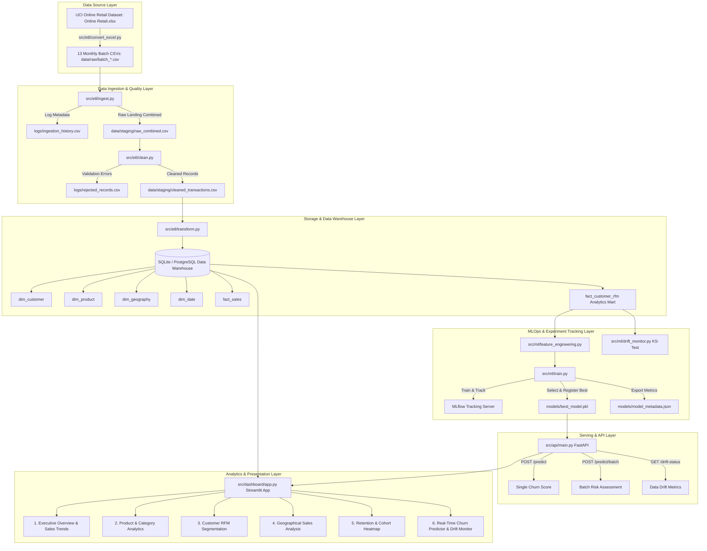

# System Architecture & Technical Pipeline Flow

## Architecture Overview

The **E-Commerce Sales Analytics & Customer Churn Prediction Platform** is engineered following modular Data Engineering and MLOps best practices. It comprises 6 key conceptual layers:

---

## Technical Flow Description

1. **Ingestion & Data Quality Gate**:
   - `ingest.py` ingests multi-month CSV extracts into `data/staging/raw_combined.csv` while logging row counts and timestamp metadata to `logs/ingestion_history.csv`.
   - `clean.py` validates records against strict rules (null CustomerIDs, unparseable dates, negative unit prices, zero quantities). Invalid records are recorded in `logs/rejected_records.csv`.

2. **Star Schema Data Warehouse**:
   - `transform.py` builds standard dimensions (`dim_customer`, `dim_product`, `dim_geography`, `dim_date`) and facts (`fact_sales`, `fact_customer_rfm`).
   - Customer inactivity > 90 days generates the ground-truth target variable `churn_label` in `fact_customer_rfm`.

3. **MLOps Model Pipeline**:
   - `feature_engineering.py` extracts RFM, order frequency velocity, item volume, cancellation rate, product diversity, and active months.
   - `train.py` trains **Logistic Regression**, **Random Forest**, and **XGBoost** models.
   - Experiments, parameters, and metrics (Accuracy, Precision, Recall, F1, ROC-AUC) are logged in **MLflow**.
   - The top model (`random_forest` with ROC-AUC = 1.0000) is saved to `models/best_model.pkl`.

4. **FastAPI & Streamlit Presentation**:
   - `src/api/main.py` provides high-throughput predictions (`/predict`, `/predict/batch`, `/drift-status`).
   - `src/dashboard/app.py` serves a 6-tab dashboard with interactive Plotly visual analytics and a live churn prediction calculator.
